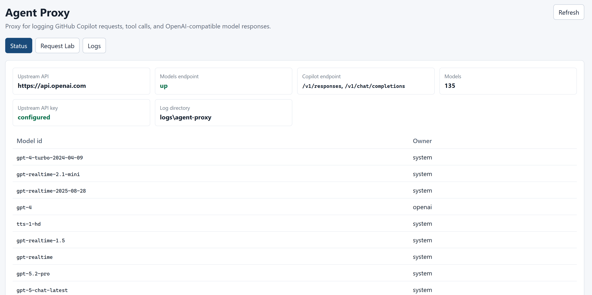
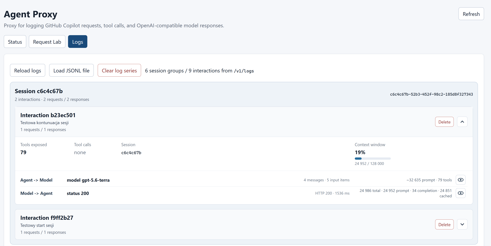
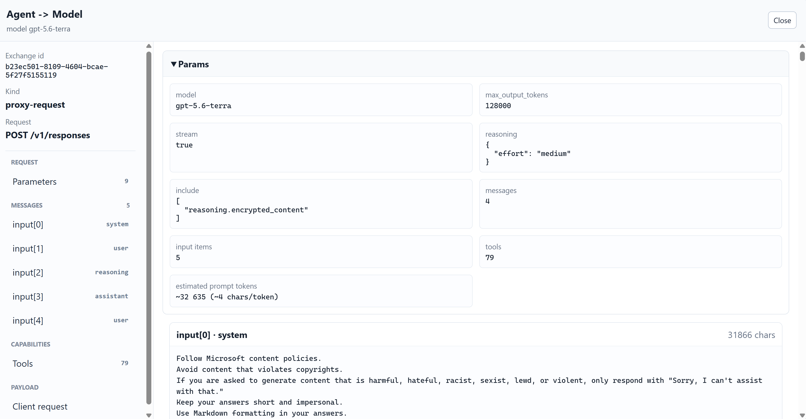
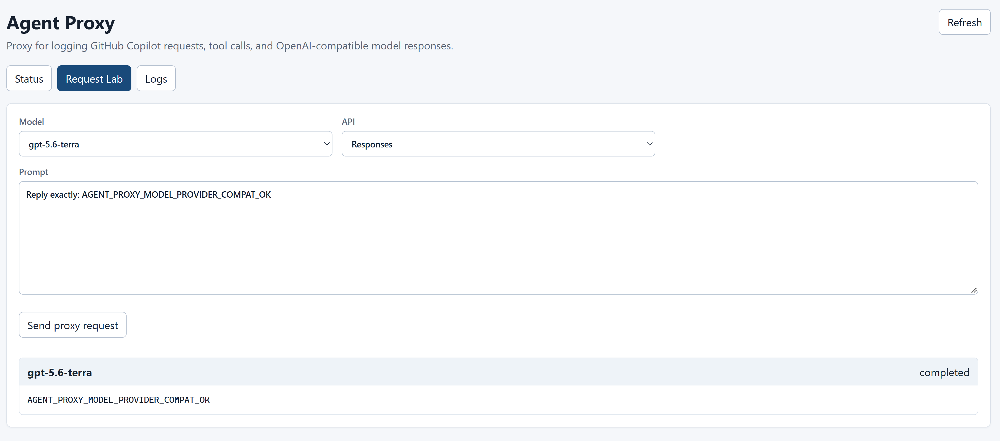

# Agent Proxy

Agent Proxy to lokalne proxy dla GitHub Copilot w VS Code. Copilot korzysta z konfiguracji **Custom Endpoint**, wysyła żądania Responses API lub Chat Completions do Agent Proxy, a Agent Proxy przekazuje je do skonfigurowanego API zgodnego z OpenAI, np. OpenAI API. Requesty, odpowiedzi i błędy zapisuje w JSONL i pokazuje w interfejsie webowym.

```text
GitHub Copilot w VS Code
    -> http://127.0.0.1:8081/v1/responses (lub /v1/chat/completions)
    -> ta sama ścieżka w skonfigurowanym upstreamie
    -> odpowiedź wraca przez Agent Proxy do Copilota
```

Copilot zarządza historią, kontekstem i wykonywaniem narzędzi. Agent Proxy przekazuje całe body bez tłumaczenia na inny protokół. W Responses zachowuje `input`, `instructions`, `reasoning`, `tools`, `previous_response_id` i zaszyfrowane elementy reasoning. Model zwraca `function_call`, Copilot wykonuje narzędzie lokalnie, a wynik odsyła jako `function_call_output`. W Chat Completions odpowiednikami są `messages`, `tool_calls` i wiadomości `role=tool`.

Dla GPT-5.6 Terra korzystającego z narzędzi i reasoning wybierz Responses API. OpenAI odrzuca tę kombinację przez Chat Completions; alternatywą jest `reasoning_effort: "none"`. Zobacz [function calling w OpenAI API](https://developers.openai.com/api/docs/guides/function-calling).

## Struktura projektu

- `src/main/` — backend i zasoby aplikacji.
- `src/test/` — testy backendu i integracji z lokalnym upstreamem HTTP.
- `frontend/` — interfejs Angular i konfiguracja budowania.
- `docs/images/` — zrzuty interfejsu używane w README.
- `pom.xml` — konfiguracja budowania aplikacji.
- `logs/` — logi działającego Agent Proxy; katalog ignorowany przez Git.
- `playground/` — lokalne archiwum eksperymentów, wyników, starych logów, prezentacji, notatek i projektów koncepcyjnych; katalog ignorowany przez Git.

## Wymagania i konfiguracja

Wymagane są Java 21+, Maven 3.9+, Node.js i npm zgodne z zależnościami frontendu (np. Node.js 22+) oraz dostęp do Responses API lub OpenAI Chat Completions.

```powershell
$env:AGENT_PROXY_OPENAI_COMPATIBLE_API_KEY = "sk-..."
$env:AGENT_PROXY_OPENAI_COMPATIBLE_BASE_URL = "https://api.openai.com"
```

| Ustawienie | Domyślnie | Znaczenie |
|---|---|---|
| `agent-proxy.openai-compatible.base-url` | `https://api.openai.com` | Bazowy URL upstreamu, bez końcowego `/v1`. Agent Proxy dodaje `/v1/models`, `/v1/responses` albo `/v1/chat/completions`. |
| `agent-proxy.openai-compatible.api-key` | klucz z konfiguracji | Klucz serwerowy używany do połączeń z upstreamem. |
| `agent-proxy.log-directory` | `logs/agent-proxy` | Katalog dziennych plików JSONL. |
| `server.port` | `8081` | Port backendu i zbudowanego interfejsu. |

Ustawienia można nadpisać zmiennymi `AGENT_PROXY_OPENAI_COMPATIBLE_BASE_URL`, `AGENT_PROXY_OPENAI_COMPATIBLE_API_KEY`, `AGENT_PROXY_LOG_DIRECTORY` i `SERVER_PORT`.

Starsze właściwości `agent-proxy.model-provider-base-url` i `agent-proxy.model-provider-api-key` nadal działają jako wartości zastępcze, jeżeli odpowiadające im ustawienia `openai-compatible` są puste.

Agent Proxy uwierzytelnia upstream własnym kluczem serwerowym. Nie przekazuje klucza otrzymanego od Copilota. Klucze przekazuj przez środowisko i nie zapisuj ich w repozytorium.

## Uruchomienie

```powershell
npm --prefix frontend ci
npm --prefix frontend run build
mvn -q clean package "-Dexec.skip=true"
java -jar target/agent-proxy-0.0.1-SNAPSHOT.jar
```

Interfejs: `http://127.0.0.1:8081`. Najpierw Angular zapisuje gotowy frontend w `src/main/resources/static/`, następnie Maven uruchamia testy backendu i dołącza zasoby do JAR-a. `-Dexec.skip=true` pomija ponowne wywołanie npm przez Maven. Obecne zadania npm w `pom.xml` są przypięte do `prepare-package`, po kopiowaniu zasobów; wcześniejsze zbudowanie frontendu zapewnia aktualny interfejs także przy pierwszym uruchomieniu projektu. Testy frontendu uruchamia się osobno przez `npm --prefix frontend test`.

Przed ponownym pakowaniem zakończ proces uruchomiony z tego JAR-a; na Windows działający proces Java blokuje jego nadpisanie.

W trybie developerskim uruchom backend przez `mvn -q spring-boot:run`, a frontend w drugim terminalu:

```powershell
cd frontend
npm install
npm start
```

Angular działa pod `http://127.0.0.1:4200` i przekazuje żądania `/v1/*` do backendu na porcie 8081.

## Podłączenie GitHub Copilot

W VS Code uruchom **Chat: Manage Language Models**, wybierz **Add Models → Custom Endpoint**, podaj nazwę i klucz endpointu, a następnie wybierz **Responses**. VS Code otworzy `chatLanguageModels.json`. Konfigurację opisuje [dokumentacja VS Code](https://code.visualstudio.com/docs/agent-customization/language-models#_add-a-custom-endpoint-model).

Przykład wpisu; zachowaj referencję `apiKey` utworzoną przez konfigurator:

```json
[
  {
    "name": "Agent Proxy",
    "vendor": "customendpoint",
    "apiKey": "${input:agentProxyApiKey}",
    "apiType": "responses",
    "models": [
      {
        "id": "gpt-5.6-terra",
        "name": "gpt-5.6-terra via agent-proxy",
        "url": "http://localhost:8081/v1/responses",
        "toolCalling": true,
        "vision": true,
        "contextWindow": 272000,
        "maxOutputTokens": 128000,
        "thinking": true,
        "supportsReasoningEffort": ["low", "medium", "high", "xhigh"],
        "reasoningEffortFormat": "responses"
      }
    ]
  }
]
```

Ustaw rzeczywisty identyfikator modelu dostępnego w upstreamie oraz odpowiednie limity i możliwości. Podane limity są przykładową konfiguracją klienta. Pole `model` jest przekazywane bez zmiany, więc lokalny alias nie zastąpi identyfikatora upstreamu.

Dla sesji Copilot w Agent Host włącz w `settings.json` opcję `"chat.agentHost.byokModels.enabled": true`. W nowym selektorze modeli wybierz grupę **Agent Proxy** przez przycisk providera (początkowo **Copilot**), a następnie model **gpt-5.6-terra via agent-proxy**.

W konfiguratorze możesz podać niepusty lokalny placeholder klucza: Agent Proxy używa własnego klucza upstreamu. Następnie wybierz dodany model w Copilot Chat i wykonaj zadanie w trybie Agent. W Agent Proxy otwórz **Logs → Reload logs**.

Agent Proxy zapisuje wyłącznie wywołania skierowane na jego endpoint. Inne modele lub funkcje Copilota używające innego endpointu nie pojawią się w tych logach.

## Request Lab

Request Lab pozwala wysłać prosty prompt przez to samo proxy, bez uruchamiania Copilota. Wybierz konkretny model z listy upstreamu oraz API: **Responses** (wybrane początkowo) lub **Chat Completions**. Formularz może podpowiedzieć ostatni model widoczny w logach, jeśli nadal znajduje się na liście. Bez wybranego modelu lub niepustego promptu wysyłanie jest zablokowane; nie ma opcji „default”. Lista modeli może obejmować także modele przeznaczone do innych zadań, więc wybierz model obsługujący wskazane API tekstowe.

Żądanie zawiera jawne `model` i `stream: false`; Responses dodatkowo `store: false`. Lab pokazuje tekst odpowiedzi i komunikat błędu upstreamu wraz ze statusem HTTP. Cała wymiana trafia do **Logs**. Format opisuje [dokumentacja generowania tekstu OpenAI](https://developers.openai.com/api/docs/guides/text).

## Interfejs

**Status — sprawdzenie połączenia.** Widok pokazuje adres upstreamu, dostępność endpointu modeli, obecność klucza API, katalog logów oraz obsługiwane ścieżki proxy. Lista poniżej pochodzi z `/v1/models` upstreamu i pozwala sprawdzić identyfikatory modeli dostępnych dla skonfigurowanego klucza.



**Logs — od wiadomości użytkownika do odpowiedzi modelu.** Wspólny box sesji zawiera kolejne interakcje Copilota. Jedna interakcja obejmuje wiadomość użytkownika oraz związane z nią wywołania modelu i narzędzi. Nagłówki są początkowo zwinięte; chevron obok **Delete** rozwija szczegóły. Wiersze **Agent → Model** i **Model → Agent** pokazują kierunek przepływu, status HTTP, czas odpowiedzi i zużycie tokenów. Ikona oka otwiera pełny podgląd wybranej części wymiany.



**Szczegóły requestu — co otrzymał model.** Podgląd rozdziela parametry generacji, wiadomości, definicje narzędzi i surowy payload. Dla Responses API widać elementy `input`, role wiadomości oraz elementy reasoning. Nawigacja po lewej pozwala przejść do konkretnej wiadomości lub narzędzia i sprawdzić kontekst wysłany przez Copilota.



**Request Lab — próba połączenia z modelem.** Wybór konkretnego modelu i wysłanie krótkiego promptu sprawdza przepływ przeglądarka → Agent Proxy → upstream → Agent Proxy → przeglądarka. Na zrzucie `gpt-5.6-terra` przez API **Responses** zwraca oczekiwany tekst `AGENT_PROXY_MODEL_PROVIDER_COMPAT_OK` ze statusem `completed`. Przycisk **Send proxy request** wysyła żądanie; odpowiedź pojawia się poniżej formularza, a całą wymianę można obejrzeć w **Logs**. Formularz obsługuje również Chat Completions.



## API i logowanie

| Endpoint | Działanie |
|---|---|
| `GET /v1/models` | Przekazuje zapytanie do upstreamu i zwraca listę modeli. Nie zapisuje tej operacji w logach wymian. |
| `POST /v1/chat/completions` | Przekazuje JSON requestu i odpowiedź upstreamu, zapisując wymianę. |
| `POST /v1/responses` | Przekazuje JSON requestu oraz odpowiedź JSON/SSE bez zmiany formatu, zapisując wymianę. |
| `GET /v1/status` | Zwraca `baseUrl`, `apiKeyConfigured` i `logDirectory`, bez wartości klucza. |
| `GET /v1/logs?limit=100` | Zwraca najnowsze wpisy jako `{"entries": [...]}`; limit jest ograniczany do zakresu 1–500. |
| `DELETE /v1/logs` | Usuwa wszystkie pliki JSONL z katalogu logów. |
| `DELETE /v1/logs/interactions/{interactionId}` | Usuwa wszystkie wymiany z podanym identyfikatorem korelacji `x-interaction-id`; może obejmować wiele sesji. |
| `DELETE /v1/logs/exchanges` | Usuwa tylko wskazane wymiany, z body `{"ids": ["exchange-id"]}`. UI używa tej operacji do usuwania pojedynczej interakcji. |

Każdy wiersz w `logs/agent-proxy/YYYY-MM-DD.jsonl` jest osobnym obiektem. Typ wpisu to `proxy-request`, `proxy-response` lub `proxy-error`. Wspólne pole `id` łączy request z odpowiedzią lub błędem. Request zawiera metodę, ścieżkę, adres upstreamu, nagłówki, całe body i liczbę narzędzi. Odpowiedź zawiera status, nagłówki, body, czas i informacje o próbie.

## Widok logów

UI rozpoznaje sesję Copilot Agent Host po UUID w `Session folder` w systemowym lub developerskim `<session_context>` (`.copilot/session-state/<UUID>`), również gdy kontekst pochodzi z `instructions`. `x-interaction-id` jest identyfikatorem korelacji; w obserwowanym ruchu Copilota jest wspólny dla różnych sesji, więc nie służy jako ich identyfikator. Gdy brakuje rzeczywistego ID sesji, UI pokazuje `Session unknown` przy grupowaniu po korelacji lub `Without session ID` przy braku obu identyfikatorów. Kontekst wpisany w wiadomości użytkownika nie jest źródłem ID sesji.

Wspólny box sesji zawiera osobne interakcje dla kolejnych wiadomości użytkownika. Grupowanie korzysta z ostatniej wiadomości użytkownika i jej pozycji w historii; wywołania narzędzi i ponowienia pozostają w tej samej interakcji. Kontynuacje Responses bez wiadomości użytkownika są łączone przez `previous_response_id`. Rozpoznane pomocnicze zapytania Copilota o uprawnienia są dołączane do bieżącej interakcji. Request i odpowiadające mu wpisy odpowiedzi/błędu są wyświetlane obok siebie także przy równoległych wywołaniach. Wymiany bez rozpoznanej wiadomości użytkownika lub powiązania z wcześniejszą odpowiedzią pozostają osobnymi wymianami. Przycięcie historii, identyczne wiadomości bez pełnej historii lub równoległe zapytania pomocnicze bez ID sesji mogą uniemożliwić jednoznaczne odtworzenie powiązań.

Interakcje są domyślnie zwinięte do nagłówka z treścią wiadomości i liczbą requestów/odpowiedzi. Chevron po prawej, obok **Delete**, rozwija i zwija szczegóły; działa również klawiaturą. **Reload logs** zachowuje stan rozwinięcia nadal widocznych interakcji. Po pełnym przeładowaniu strony wszystkie interakcje są ponownie zwinięte.

Szczegóły obejmują wiadomości, narzędzia, tekst odpowiedzi, argumenty wywołań narzędzi, usage i surowy JSON/SSE. **Delete** usuwa tylko wymiany wybranej interakcji, zachowując pozostałe interakcje sesji. **Clear log series** usuwa wszystkie pliki JSONL. Można też wczytać lokalny plik przez **Load JSONL file**; jest parsowany wyłącznie w przeglądarce. Dla wczytanego pliku **Hide** ukrywa interakcję, a **Clear view** czyści widok bez modyfikowania pliku.

Widok serwerowy pobiera ostatnie 100 wpisów, a nie 100 kompletnych interakcji. Liczniki dotyczą wczytanych danych; starsze fragmenty sesji mogą być niewidoczne. API pozwala pobrać do 500 wpisów, a import JSONL obejmuje cały wczytany plik. Po zmianie wersji UI można wymusić pobranie nowych zasobów przez **Ctrl+F5**.

Jeśli upstream nie zwróci `usage`, UI oznacza estymację tokenów jako przybliżenie. Heurystyka około czterech znaków na token nie zastępuje tokenizera modelu. Wskaźnik **Context window** korzysta z limitu przypisanego w kodzie UI, domyślnie 128 000; nie odczytuje `contextWindow` z konfiguracji VS Code ani limitu z API modelu. Procent wykorzystania kontekstu może więc nie odpowiadać rzeczywistemu limitowi modelu.

## Buforowanie i ponowienia

Agent Proxy odczytuje całą odpowiedź upstreamu przed odesłaniem jej do Copilota. Dla `stream=true` zachowuje body SSE, ale nie przekazuje tokenów na żywo.

Dla udanej odpowiedzi Chat Completions sprawdza kompletność: JSON musi zawierać niepuste `choices`, a SSE co najmniej jeden wybór, `finish_reason` i `data: [DONE]`. Niekompletną odpowiedź ponawia raz. Obie próby trafiają do logów z polami `attempt`, `complete` oraz, przy błędzie, `validationError` i `willRetry`. Po drugiej niekompletnej odpowiedzi zwraca `502` z typem `agent_proxy_incomplete_upstream_response`. Ponowienie może oznaczać dodatkowe użycie API.

Responses API ma własny cykl życia, m.in. `response.completed`, `response.failed` i `response.incomplete`. Agent Proxy przekazuje go bez wymogu `choices`, `finish_reason` lub `[DONE]` i bez automatycznego ponawiania. Zachowuje również odpowiedzi `queued` i puste `output`. W tym protokole pole logu `complete` oznacza zakończenie odbioru HTTP, a status generacji należy odczytać z body.

Statusy błędów HTTP upstreamu są przekazywane klientowi bez ponawiania. Wyjątki transportu kończą się `502`. Połączenie ma timeout 30 sekund, a całe żądanie 10 minut.

## Ograniczenia

- Agent Proxy nie wykonuje narzędzi ani nie zmienia historii dostarczanej przez Copilota.
- Do upstreamu przekazuje dodatkowo tylko nagłówki `openai-beta`, `openai-organization` i `openai-project`. Identyfikator interakcji jest zachowany w lokalnym logu.
- Wrażliwe nagłówki są maskowane, ale body może zawierać poufne dane.
- Lokalny interfejs i endpointy nie mają własnego uwierzytelnienia.
- Podgląd tokenów i kontekstu zależy od danych upstreamu i przybliżeń UI.

## Weryfikacja

```powershell
npm --prefix frontend ci
npm --prefix frontend test
npm --prefix frontend run build
mvn -q clean test
```

Testy integracyjne korzystają z lokalnego serwera HTTP i nie wywołują prawdziwego API modelu. Sprawdzają oba protokoły, pełną wymianę narzędzia z reasoning w Responses, podmianę klucza, JSON/SSE, logowanie i zachowanie błędów upstreamu. Testy frontendu sprawdzają podgląd Responses, scalanie delt i końcowych zdarzeń bez powielania tekstu lub argumentów oraz grupowanie sesji, wiadomości użytkownika, wywołań narzędzi i zapytań pomocniczych. Testy backendu obejmują też usuwanie wybranych wymian bez usuwania innych interakcji sesji. Zwijanie, rozwijanie i zachowanie stanu po wczytaniu logów zostały sprawdzone ręcznie w przeglądarce; nie są objęte testami automatycznymi.
